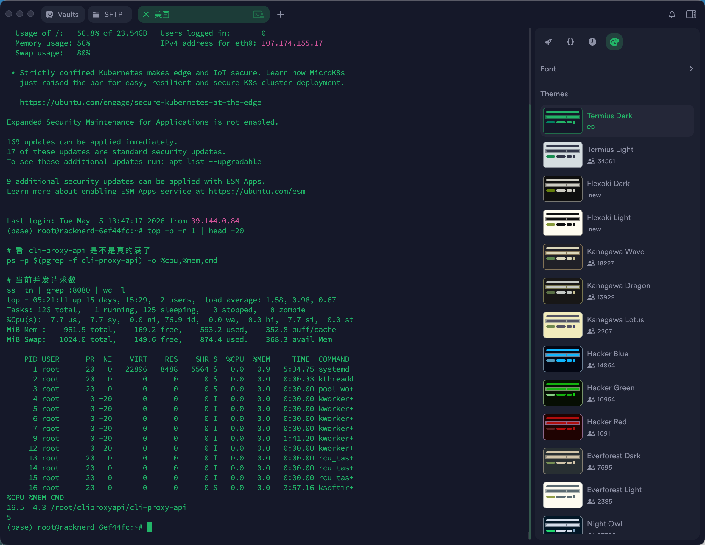

# 部署到 VPS — Cloudflare 反代版

最简方案：VPS 只跑 Node.js + PM2，**Cloudflare 接管 HTTPS、SSL、缓存、防 DDoS**。

> 架构：
>
> ```
> 用户浏览器 ──HTTPS──▶ Cloudflare 边缘 ──HTTP──▶ 107.174.155.17:3001 (Next.js)
> ```
>
> 不需要 nginx、不需要 certbot、不需要在 VPS 上管证书。

---

## 0. 前置条件

- ✅ 域名 `nassaapi.xyz` 已托管到 Cloudflare（你说已经搞了）
- ✅ VPS `107.174.155.17` 你能 SSH 进去
- ✅ 你的电脑能 `ssh root@107.174.155.17` 通

---

## 1. 在 VPS 上装环境（5 分钟）

SSH 进去后一次性装好：

```bash
# Node 20 LTS
curl -fsSL https://deb.nodesource.com/setup_20.x | bash -
apt install -y nodejs build-essential rsync git

# 全局 PM2
npm install -g pm2

# 必要目录
mkdir -p /opt/nassaapi-frontend /var/lib/nassaapi/data /var/log/nassaapi
```

---

## 2. 在 Mac 上推代码到 VPS（2 分钟）

回到 Mac 终端：

```bash
cd /Users/w/Desktop/newapi/nassaapi-frontend

rsync -avz --delete \
  --exclude='node_modules' \
  --exclude='.next' \
  --exclude='.env.local' \
  --exclude='data/' \
  --exclude='.git/' \
  --exclude='.DS_Store' \
  ./ root@107.174.155.17:/opt/nassaapi-frontend/
```

---

## 3. 在 VPS 上构建 + 配环境（5 分钟）

SSH 回 VPS：

```bash
cd /opt/nassaapi-frontend
npm install
cp .env.example .env.production.local
nano .env.production.local
```

填这些值：

```ini
# 后台登录（强密码）
ADMIN_USERNAME=admin
ADMIN_PASSWORD=换成强密码至少20位

# New API 后端 — 同台 VPS 直接走 localhost
NEWAPI_BASE_URL=http://127.0.0.1:8317
NEWAPI_ADMIN_TOKEN=你的真实 access_token
NEWAPI_ADMIN_USER_ID=1
NEWAPI_QUOTA_PER_UNIT=500000

# SQLite 持久化
NASSAAPI_DATA_DIR=/var/lib/nassaapi/data

# 机器人共享密钥（从 Mac .env.local 复制）
BOT_SHARED_SECRET=088abae5836043d3b347a20013afc13df04706684c00d85e95dd4748ebd55185
```

> 不知道 New API 端口？跑：`ss -tlnp | grep -E '(node|api)' | head` 看哪个端口在监听。或者临时填 `https://api.nassaapi.xyz`（绕一圈公网，能用但慢）。

构建 + 启动：

```bash
npm run build
pm2 start ecosystem.config.cjs
pm2 save
pm2 startup
# 按提示再执行它给出的那一行 systemctl 命令
```

测试本地是否起来：

```bash
curl http://127.0.0.1:3001/api/bot/redeem
# 应该返回 {"ok":true,...,"secret_configured":true,...}
```

---

## 4. 开放 3001 端口给公网（1 分钟）

> 注意：原本默认端口 3000 但你 VPS 上已被其它 Docker 容器占用，所以本指南统一用 **3001**。

让 Cloudflare 边缘能连进来：

```bash
# 如果你用 ufw
ufw allow 3001/tcp
ufw reload

# 如果用 firewalld（CentOS/Rocky）
firewall-cmd --permanent --add-port=3001/tcp
firewall-cmd --reload

# 如果用 iptables 直接
iptables -A INPUT -p tcp --dport 3001 -j ACCEPT
```

测试外网能否访问：在 **Mac 上**（关掉 WARP）跑：

```bash
curl http://107.174.155.17:3001/api/bot/redeem
# 应该跟上面 VPS 内 curl 一样返回
```

> ⚠️ 现在 `http://107.174.155.17:3001` 全世界都能直连（暴露源 IP）。等 Cloudflare 配好后建议加 firewall 白名单只放 CF IP — 见文末「加固」。

---

## 5. 配 Cloudflare（3 分钟）

打开 [dash.cloudflare.com](https://dash.cloudflare.com) → 选 `nassaapi.xyz`。

### 5.1 加 DNS A 记录

**DNS → Records → Add record**：

| 字段 | 值 |
|---|---|
| Type | A |
| Name | `redeem` |
| IPv4 | `107.174.155.17` |
| Proxy status | **Proxied**（橙色云朵 ☁️） |
| TTL | Auto |

保存。

### 5.2 加 Origin Rule（端口转发到 3001）

**Rules → Origin Rules → Create rule**：

| 字段 | 值 |
|---|---|
| Rule name | `redeem-port-3001` |
| When incoming requests match | Custom filter expression |
| Field | `Hostname` |
| Operator | `equals` |
| Value | `redeem.nassaapi.xyz` |
| Then... | **Rewrite to** |
| Origin Port | `3001` |

保存 + Deploy。

> 这条规则的意思：访客访问 `https://redeem.nassaapi.xyz` 时，CF 边缘会从 origin 的 **3001 端口**取数据，而不是默认的 80/443。

### 5.3 SSL/TLS 模式

**SSL/TLS → Overview → Encryption mode**：

选 **Flexible**（访客 → CF 用 HTTPS，CF → origin 用 HTTP，跟我们 Node 不开 SSL 匹配）。

> 千万别选 "Full / Strict"，会失败因为 origin 没装证书。

### 5.4 验证

打开浏览器访问：

```text
https://redeem.nassaapi.xyz/api/bot/redeem
```

应该看到那个 JSON：`{"ok":true, "secret_configured":true, ...}`

如果 502 / 521 / 522 → 看「排错」一节。

---

## 6. 更新闲鱼机器人配置

机器人后台 `http://localhost:9000` → 自动发货 → API 配置，URL 改成：

```text
https://redeem.nassaapi.xyz/api/bot/redeem
```

`X-Bot-Secret` 不用改（VPS 和 Mac 用了同一个 secret）。

---

## 7. 后续日常更新（最简流程）

代码改完想发布，**Mac 上跑一句**：

```bash
bash deploy/sync-to-vps.sh
```

会自动 rsync + npm install + build + pm2 reload。

紧急小改不重 build：

```bash
bash deploy/sync-to-vps.sh --no-build
```

---

## 8. 排错

### CF 521 Web Server Down

VPS 上 PM2 没起来 / 端口 3001 没监听。

```bash
pm2 status
ss -tlnp | grep 3001
```

### CF 522 Connection Timed Out

防火墙没放 3001 端口给 CF。检查：

```bash
ufw status      # 看 3001/tcp 是不是 ALLOW
```

### CF 502 Bad Gateway / Origin Rule 没生效

CF Rules → Origin Rules 里看刚才那条是不是 "Active"。

### Bot 调用 API 401

`X-Bot-Secret` 和 VPS 的 `BOT_SHARED_SECRET` 不一致。

```bash
# VPS 上
grep BOT_SHARED_SECRET /opt/nassaapi-frontend/.env.production.local
```

跟机器人后台 API 配置里的对照，必须**完全相同**。

---

## 9. 加固（部署完做一遍）

### 9.1 防火墙只允许 CF IP 访问 3001

CF 把流量从他们的 IP 段发过来。我们可以只放 CF IP，挡掉其他直连 origin 的请求。

在 VPS 上：

```bash
# 下载 CF 官方 IP 列表
curl -s https://www.cloudflare.com/ips-v4 -o /tmp/cf-ips-v4.txt

# 删掉之前的 "allow 3001" 全开规则
ufw delete allow 3001/tcp 2>/dev/null

# 只让 CF IP 段访问 3001
while read ip; do ufw allow from "$ip" to any port 3001 proto tcp; done < /tmp/cf-ips-v4.txt
ufw reload

# 验证（在 Mac 上）
curl -m 5 http://107.174.155.17:3001   # 应该超时（CF 之外不让进）
curl https://redeem.nassaapi.xyz/api/bot/redeem  # 应该正常（走 CF）
```

> ⚠️ CF 偶尔会变更 IP 段，建议每月跑一次同样命令更新白名单（也可以加 cron）。

### 9.2 SQLite 自动备份

```bash
crontab -e
# 添加：
0 3 * * * cp /var/lib/nassaapi/data/redemptions.db /var/lib/nassaapi/data/redemptions.db.$(date +\%Y\%m\%d).bak && find /var/lib/nassaapi/data -name 'redemptions.db.*.bak' -mtime +30 -delete
```

### 9.3 安全 Checklist

- [ ] `ADMIN_PASSWORD` 强密码 20+ 位
- [ ] `BOT_SHARED_SECRET` 64 位随机串
- [ ] `.env.production.local` 权限 `chmod 600`
- [ ] `https://redeem.nassaapi.xyz/admin/redeem` 弹 Basic Auth 框
- [ ] 防火墙只放 CF IP（见 9.1）
- [ ] SQLite cron 备份已配（见 9.2）
- [ ] CF SSL/TLS 模式 = Flexible
- [ ] CF Origin Rule "redeem-port-3001" 已 Active
